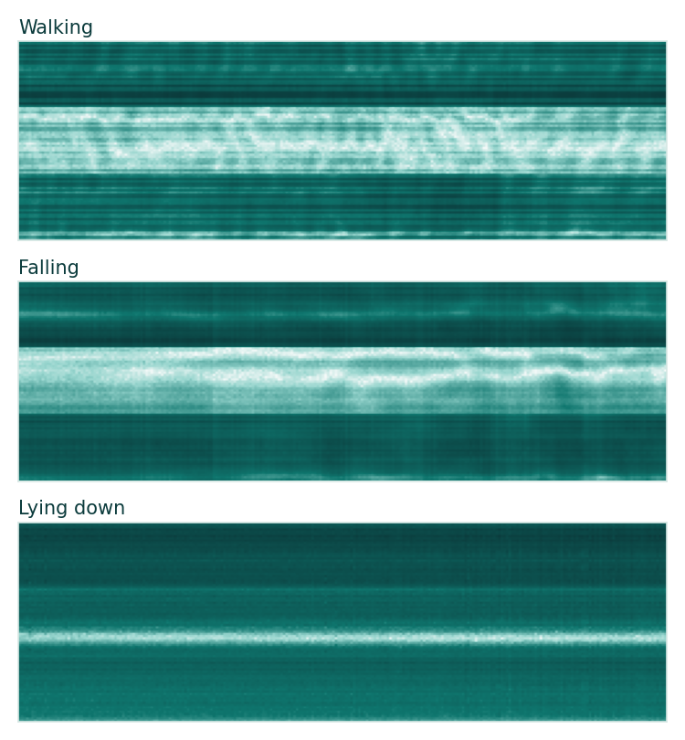

# FallGuard

**Privacy-first fall detection for elderly care, using only Wi-Fi signals.** No cameras, no wearables.

Falls are a leading cause of injury for older adults living alone. Cameras invade privacy and wearables get forgotten, but Wi-Fi is already in every home. When a person moves or falls, they disturb the Wi-Fi signal in recognizable ways. FallGuard reads those disturbances (Channel State Information, CSI), detects falls, alerts a caregiver, and escalates if the person does not recover.

*Walking, falling, and lying down as seen through Wi-Fi CSI. You can tell someone fell, but not who they are.*

## Features

- **Fall detection** from Wi-Fi CSI with an MLP classifier over 7 activities
- **AI caregiver alerts** written by Llama 3.1 70B via Snowflake `AI_COMPLETE`
- **Real email notifications** through Snowflake `SYSTEM$SEND_EMAIL`
- **Escalation:** if there is no recovery within 5 minutes, FallGuard triggers an emergency call (simulated in demo mode) and logs it to a Snowflake table
- **Live dashboard** with current activity, live signal view, and an activity timeline
- **Daily summary and caregiver Q&A** grounded in the day's activity log

## Architecture

1. **Sensing:** Wi-Fi CSI recordings (UT-HAR: 3 antennas x 30 subcarriers x 250 time steps)
2. **Inference:** MLP classifier (lie down, fall, walk, pick up, run, sit down, stand up). In a real deployment this runs at the edge, on or near the Wi-Fi device
3. **Storage:** predictions logged to `FALLGUARD.APP.ACTIVITY_LOG`
4. **AI reasoning:** `AI_COMPLETE` (Llama 3.1 70B, open-weight) for alerts, summaries, and Q&A
5. **Alerting:** `SYSTEM$SEND_EMAIL` for caregiver and escalation emails; escalations logged to `FALLGUARD.APP.ESCALATIONS`
6. **App:** Streamlit running inside Snowflake

Data, AI, alerting, and the app all run in one Snowflake account, with no separate services stitched together.

## Results

| Metric | Test accuracy |
|---|---|
| Fall detection | 84% |
| Overall (7 activities) | 72% |

## Demo note

The dashboard replays a simulated day built from **real UT-HAR test recordings** classified by our model, so it behaves like a live feed. The emergency call is simulated (`DEMO_MODE = True`); in production it would route to a professional monitoring center, which is how medical alert systems handle dispatch.

## Files

- `fallguard.py`: trains the classifier, reports accuracy, builds the demo activity log
- `to_sql.py`: converts the log into a Snowflake INSERT statement
- `heatmap.py`, `signatures.py`: generate the Wi-Fi signal visuals
- `setup.sql`: Snowflake tables, email integration, AI check
- `streamlit_app.py`, `.streamlit/config.toml`, `signals/`: the dashboard

## Run it

1. Download processed UT-HAR from the SenseFi repo into `Data/UT_HAR/`
2. `python3 fallguard.py`
3. Run `setup.sql` in Snowflake, then `python3 to_sql.py` and execute its output
4. `python3 signatures.py`
5. Create a Streamlit app in Snowflake with `streamlit_app.py`, `.streamlit/config.toml`, and `signals/`

## Credits

- [SenseFi](https://github.com/xyanchen/WiFi-CSI-Sensing-Benchmark) (MIT) for the processed UT-HAR data and loaders
- UT-HAR: Yousefi et al., "A Survey on Behavior Recognition Using WiFi Channel State Information," IEEE Communications Magazine, 2017

Built at Tech@NYU Shipyard, October 2026.

## License

MIT
